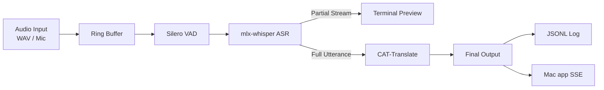

# MimiVox Architecture

Fully on-device JA→EN speech translation running on Apple Silicon via MLX.

## Table of Contents

1. [Simplified Overview](#1-simplified-overview)
2. [Detailed Streaming Pipeline](#2-detailed-streaming-pipeline)
3. [Component Reference](#3-component-reference)
   - 3.1 [Audio Capture](#31-audio-capture)
   - 3.2 [VAD Segmentation (Silero)](#32-vad-segmentation-silero)
   - 3.3 [ASR (mlx-whisper)](#33-asr-mlx-whisper)
   - 3.4 [Translation (CAT-Translate)](#34-translation-cat-translate)
   - 3.5 [Output Layers](#35-output-layers)
4. [Helper API](#4-helper-api)
   - 4.1 [Connection](#41-connection)
   - 4.2 [Event Types](#42-event-types)
5. [Performance & Latency](#5-performance--latency)
   - 5.1 [Timing Breakdown](#51-timing-breakdown)
   - 5.2 [Optimization Notes](#52-optimization-notes)
6. [Post-Processing Utilities](#6-post-processing-utilities)
7. [Project Layout](#7-project-layout)

---

## 1. Simplified Overview

### Mermaid Flowchart



### ASCII Flow

```
Audio Input (WAV / Mic) → Ring Buffer → Silero VAD
                                          │
                                          ▼
                                    Utterance Chunk
                                          │
                                          ▼
                                    mlx-whisper ASR
                                          │
                    ┌─────────────────────┼─────────────────────┐
                    │                     │                     │
                    ▼                     ▼                     ▼
              Terminal (ANSI)      Mac app (SSE)          Full Utterance
              Partial Preview      Partial Event                │
                                                                ▼
                                                        CAT-Translate
                                                                │
                              ┌─────────────────────────────────┼─────────────────────────────────┐
                              │                                 │                                 │
                              ▼                                 ▼                                 ▼
                        Terminal (ANSI)                   JSONL Log                        Mac app (SSE)
                        (Final JA/EN)                     (ND-JSON)                        (Final + Tokens)
```

---

## 2. Detailed Streaming Pipeline

```
┌──────────────────────────────────────────────────────────────────────────────────┐
│                    MimiVox — Real-time JA→EN Meeting Translator                  │
│                    Fully on-device · Apple Silicon · MLX                         │
└──────────────────────────────────────────────────────────────────────────────────┘

━━━━━━━━━━━━━━━━━━━━━━━━━━━━━━━━ AUDIO INPUT LAYER ━━━━━━━━━━━━━━━━━━━━━━━━━━━━━━━━

  WAV file or live microphone
  │
  ▼
┌─────────────────────────────────────────────────────────────────────────────────┐
│ Ring Buffer (asyncio Queue)                                                     │
│   sample_rate = 16_000                                                          │
│   channels    = mono                                                            │
│   dtype       = float32                                                         │
└─────────────────────────────────────────────────────────────────────────────────┘
  │
  ▼

━━━━━━━━━━━━━━━━━━━━━━━━━━━━━━━━━ VAD SEGMENTATION ━━━━━━━━━━━━━━━━━━━━━━━━━━━━━━━━

                         ▼
              ┌──────────────────────┐
              │      SileroVAD       │  VAD_THRESHOLD      = 0.35
              │  (onnxruntime)       │  VAD_MIN_SILENCE_MS = 700
              │  frame-by-frame      │  VAD_SPEECH_PAD_MS  = 120
              │  emit on silence     │  VAD_MIN_SPEECH_MS  = 250
              └──────────┬───────────┘  MAX_CHUNK_S        = 15
                         │
                         ▼  utterance chunk (padded speech)

━━━━━━━━━━━━━━━━━━━━━━━━━━━━━━━ ASR + TRANSLATION CORE ━━━━━━━━━━━━━━━━━━━━━━━━━━━━━

┌─────────────────────────────────────────────────────────────────────────────────┐
│ mlx_whisper.transcribe(                                                         │
│   model   = large-v3-turbo-q8,   language = "ja"                                │
│   verbose = True      ← emits "[MM:SS.mmm → MM:SS.mmm]  text" per segment       │
│   no_speech_threshold = 0.8,     condition_on_previous_text = False             │
│ )                                                                               │
│      │                                                                          │
│      │  per decoded segment (fires mid-inference)                               │
│      ▼                                                                          │
│  ┌────────────────────────────┐    ┌─────────────────────────────────────────┐  │
│  │      PARTIAL PREVIEW       │    │         FINAL TRANSLATION               │  │
│  │  (fires every segment)     │    │  (fires on utterance end)               │  │
│  ├────────────────────────────┤    ├─────────────────────────────────────────┤  │
│  │ _partial_accum += seg_text │    │  normalize_punctuation(text)            │  │
│  │ ANSI cursor-up + erase     │    │  apply_glossary(text)                   │  │
│  │ print dim "⟳  {accum}"     │    │                                         │  │
│  │ sse_broadcast(partial)     │    │  _is_mostly_english()? ──→ skip CAT     │  │
│  │                            │    │         │                               │  │
│  │                            │    │         ▼                               │  │
│  │                            │    │  async with MLX lock:                   │  │
│  │                            │    │    mlx_lm.stream_generate(CAT-1.4b-q4)  │  │
│  │                            │    │    on_token → sse_broadcast(en_token)   │  │
│  │                            │    │                                         │  │
│  │                            │    │  clean_cat_output()                     │  │
│  │                            │    │  erase accumulated partial line (ANSI)  │  │
│  │                            │    │  print "[MM:SS] JA: … / EN: …"          │  │
│  │                            │    │  sse_broadcast(final)                   │  │
│  └────────────────────────────┘    └─────────────────────────────────────────┘  │
└─────────────────────────────────────────────────────────────────────────────────┘

━━━━━━━━━━━━━━━━━━━━━━━━━━━━━━━━━━ OUTPUT LAYERS ━━━━━━━━━━━━━━━━━━━━━━━━━━━━━━━━━━━

  Terminal (ANSI)              JSONL log                  Pipeline events
  ──────────────────────────   ───────────────────────    ─────────────────────────
  ⟳  partial preview line      logs/<stem>_v3_log.jsonl   {kind: "session_start"}
  [MM:SS] JA: <japanese>       {audio_ts,                 {kind: "partial",
  [MM:SS] EN: <english>         wall_time,                  ts, ja}
  ASR / CAT / total latency     ja, en,                   {kind: "en_token",
  Summary + per-chunk stats     partial_ja,                 token}
                                translate_ms,             {kind: "final",
                                total_ms}                   ts, ja, en,
                                                           translate_ms,
                                                           total_ms}
                                                          {kind: "session_end"}

```

---

## 3. Component Reference

### 3.1 Audio Capture

Audio is captured from either a WAV file or the live microphone and placed into an asyncio queue as 16 kHz mono float32 PCM.

| Parameter | Value | Description |
|-----------|-------|-------------|
| `sample_rate` | 16,000 Hz | Target sample rate for all processing |
| `channels` | mono | Single-channel audio |
| `dtype` | float32 | Internal buffer format |

### 3.2 VAD Segmentation (Silero)

Silero VAD detects speech boundaries and emits complete utterance chunks for downstream processing.

| Parameter | Value | Description |
|-----------|-------|-------------|
| `VAD_THRESHOLD` | 0.35 | Speech detection threshold |
| `VAD_MIN_SILENCE_MS` | 700 ms | Minimum silence to split utterance |
| `VAD_SPEECH_PAD_MS` | 120 ms | Padding applied to start/end of detected speech |
| `VAD_MIN_SPEECH_MS` | 250 ms | Consecutive speech needed to open an utterance |
| `MAX_CHUNK_S` | 15 s | Hard maximum chunk duration |

Defaults live in `config.py`. The balanced and quality profiles raise the silence and chunk limits, and live mic sessions tighten silence to 400 ms and padding to 80 ms (`apply_live_vad_overrides`).

### 3.3 ASR (mlx-whisper)

Japanese transcription using a quantized Whisper model running on MLX.

| Parameter | Value | Description |
|-----------|-------|-------------|
| `model` | `LibraxisAI/whisper-large-v3-turbo-mlx-q8` | Quantized Whisper large-v3-turbo |
| `language` | `ja` | Force Japanese language detection |
| `no_speech_threshold` | 0.8 | Filter out non-speech segments |
| `condition_on_previous_text` | `False` | Prevent error propagation across utterances |
| `verbose` | `True` | Emit per-segment timestamps during inference |

**Key behavior:** `transcribe()` fires segments mid-inference, enabling the partial preview stream before the full utterance is complete.

### 3.4 Translation (CAT-Translate)

JA→EN translation using a quantized CAT-Translate model. Runs sequentially with ASR under a shared GPU lock.

| Parameter | Value | Description |
|-----------|-------|-------------|
| `model` | `hotchpotch/CAT-Translate-1.4b-mlx-q4` | Quantized CAT-Translate 1.4B |
| `_models.cat_lock` | asyncio Lock | Same lock object as `_models.asr_lock`; serializes GPU access |

**Key behavior:**
- Translation only runs after the full ASR utterance is complete
- Streaming generation via `mlx_lm.stream_generate()` emits tokens in real-time
- `_is_mostly_english()` detects English code-switching and skips translation

### 3.5 Output Layers

MimiVox can send utterances to these outputs:

| Layer | Format | Description |
|-------|--------|-------------|
| **Terminal** | ANSI | Cursor-up erase for partials; formatted `[MM:SS] JA: … / EN: …` for finals |
| **JSONL Log** | ND-JSON | One JSON object per event; written to `logs/<stem>_v3_log.jsonl` |
| **Mac app** | SSE | The helper sends live caption and status events to the app |

---

## 4. Helper API

### 4.1 Connection

The macOS app starts the Python helper on a loopback port. The app verifies the helper's TLS
certificate and sends a bearer token with each request. The `/api/*` routes provide session
control and data. `GET /api/events` streams captions and status with Server-Sent Events.

### 4.2 Event Types

| Event | Description |
|-------|-------------|
| `SessionStartedEvent` | A session starts |
| `AsrCompletedEvent` | The helper completes an utterance transcription |
| `TranslationCompletedEvent` | The helper completes a translation |
| `SessionEndedEvent` | A session ends |

---

## 5. Performance & Latency

### 5.1 Timing Breakdown

| Metric | Definition | Typical Range |
|--------|-----------|---------------|
| **ASR Latency** | Time from audio chunk end to final ASR text | ~100–400 ms |
| **Translate Latency** | Time from ASR final to CAT-Translate final | ~200–800 ms |
| **Total Latency** | End-to-end per utterance | ~300 ms – 1.2 s |
| **GPU Lock Wait** | Time ASR or CAT waits for the MLX lock | Varies with utterance density |

> **Note:** All times are approximate and depend on utterance length, model quantization, and system load.

### 5.2 Optimization Notes

| Technique | Impact |
|-----------|--------|
| **Partial Previews** | Reduces perceived latency by showing ASR results immediately |
| **`condition_on_previous_text = False`** | Prevents error propagation from previous utterances |
| **`_is_mostly_english()`** | Skips CAT-Translate for English speech, saving GPU time and avoiding hallucinations |
| **`no_speech_threshold = 0.8`** | Aggressively filters non-speech, reducing unnecessary translation |
| **Shared MLX lock** | Serializes GPU access; prevents OOM and keeps inference deterministic |
| **Streaming `en_token`** | English tokens arrive incrementally, improving perceived responsiveness |

---

## 6. Post-Processing Utilities

| Function | File | Purpose |
|----------|------|---------|
| `normalize_punctuation()` | `translate.py` | Appends `。` if a sentence ends without punctuation |
| `apply_glossary()` | `translate.py` | Fixes known mis-transcriptions using a hardcoded glossary |
| `_is_mostly_english()` | `translate.py` | Detects English code-switching; skips CAT to avoid prompt-leak hallucinations |
| `clean_cat_output()` | `translate.py` | Strips prompt-leak artifacts and stray tokens from CAT output |

---

## 7. Project Layout

```
src/mimivox/      — Python package (pipeline, models, session storage, HTTP API)
  pipeline.py     — async orchestration (workers, queues, sessions)
  server.py       — authenticated local API
  api_adapter.py  — /api/* endpoints used by the macOS app
macos/            — native SwiftUI app (see macos/README.md)
scripts/          — build, fixture, eval, and calibration tools
tests/            — pytest suite
docs/             — architecture and feature notes
data/             — runtime data (gitignored)
```
